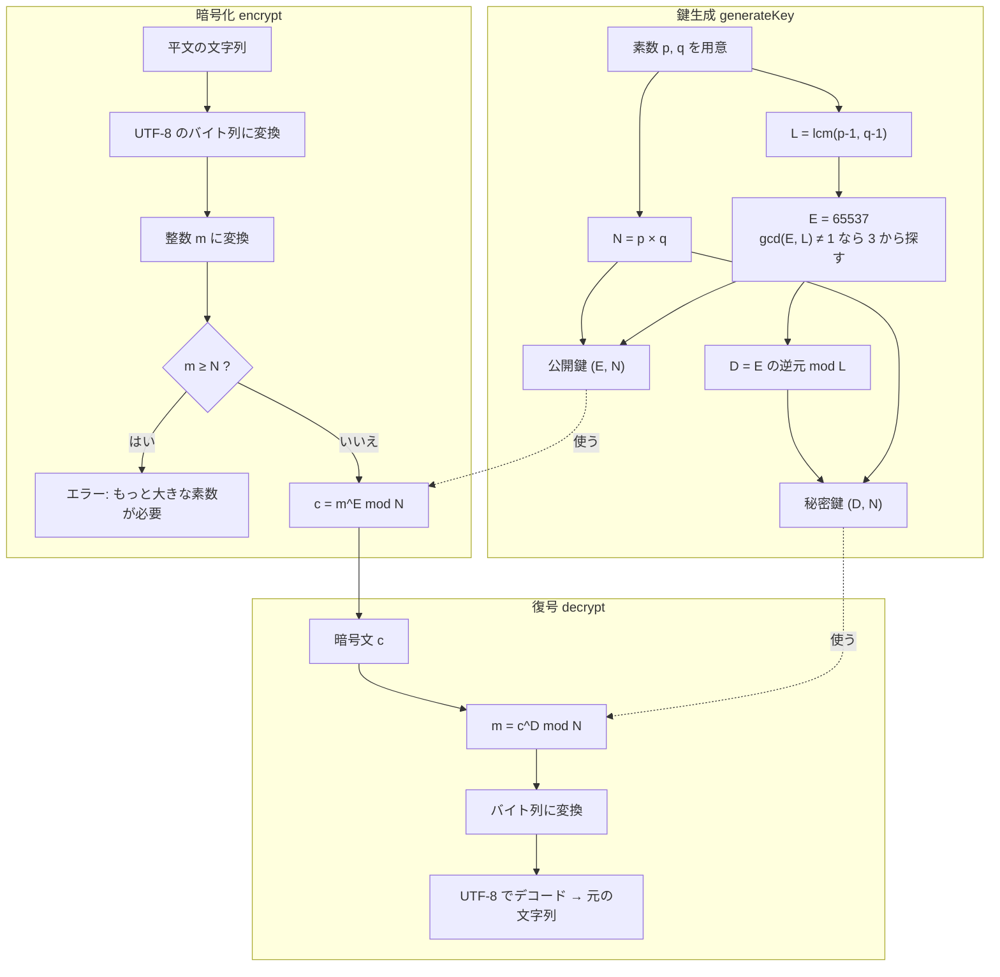
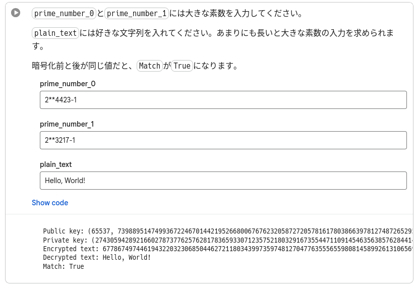
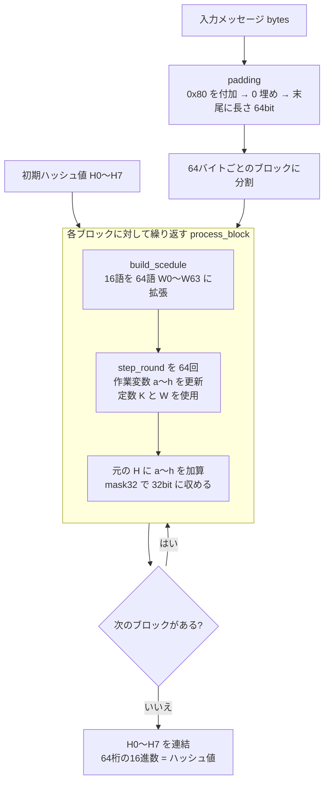
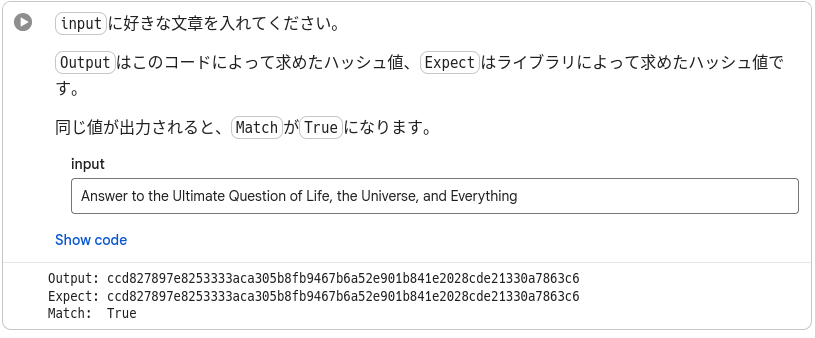

# RSA & SHA-256

## 概要

基本の非対称鍵暗号であるRSA暗号と、ハッシュ値を求めるSHA-256を実装しました。

RSAは本来共通鍵暗号の鍵の送受信に使われ文字列には使われないようですが、今回は文字列の暗号化、復号化に使いました。

### RSA

桁数が大きい合成数の素因数分解が現実的な時間内で困難だという事を安全性の根拠に利用している公開鍵暗号の一つです。

任意の文字列を、任意の二つの素数から求められた公開鍵で暗号化し、秘密鍵で復号化します。

### SHA-256

アメリカ国家安全保障局によって設計されました。

作成したハッシュ関数とライブラリのハッシュ関数の出力を比較し、正しい値が出力されているかを確認します。

## 制作者のコメント

pythonには符号無し32bit整数が存在しない為、オーバーフローの処理を用意しないといけないので、書いていて大変でした。ビット単位で行なう処理はpythonで行なう物ではないと感じました。

rsa暗号は必要となる公開鍵が大きくなってしまったため、大きい素数を探すのに少し苦労しました。

関数は出来る限り副作用が発生しないように作成し、型は明示する様にしました。型は無いより有る方が書きやすく、読み易いと感じました。今度はhaskellなどで実装してみたいと思います。

どのように動いているか知りたい時は、自分で実装するのが簡単で身に付く方法だと思います。次は楕円曲線暗号を実装したいです。

## LICENSE

Released under the [MIT LICENSE](LICENSE)
